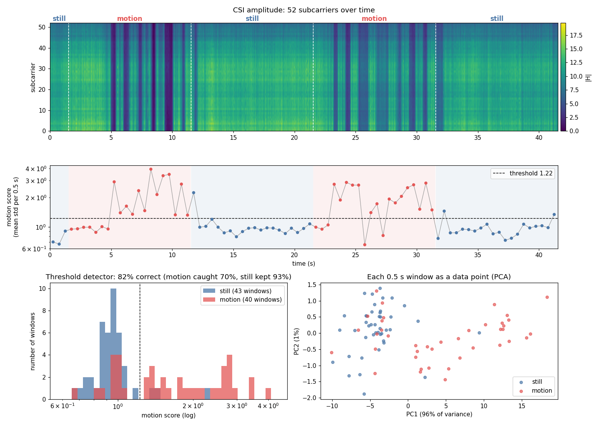

# Wi-Fi CSI sensing with ESP32-S3

Two low-cost ESP32-S3 boards measure Wi-Fi **channel state information (CSI)** from a standard
router 100 times a second and use it to recognise activity (empty, sit, wave, walk). No camera, and
nothing worn. The next question is cross-room: train in one room, measure the drop in another, and
recover part of it from unlabelled data, as in [MU-SHOT-Fi](https://arxiv.org/abs/2605.01369)
(Radwan & Tabassum).

> **Early pilot:** one room, one person, 113 clips. A simple classifier gets 64–78% on unseen
> sessions (chance 25%). The cross-room test has not been done yet.

## How it works

```
router (2.4 GHz, fixed channel)  ── ping replies, 100/s ──►  ESP32-S3 receivers (×2)
                                                                  │ CSI over USB serial
                                                                  ▼
          record ─► quality check ─► clean (DSP) ─► dataset ─► classifier
```

- Each receiver pings the router 100 times a second and reports the CSI of every reply:
  52 data subcarriers of the 20 MHz legacy training field.
- Cleaning per clip: subcarrier reordering, gain-glitch removal, resampling to an exact 100 Hz
  grid, Hampel outlier filter, 20 Hz zero-phase low-pass.
- Activities: `empty`, `walk`, `sit`, `wave`, recorded as 5 s labelled clips in random order.

## Repository layout

| Folder | Contents |
|---|---|
| [`sensing/`](sensing/) | Current pipeline: `record.py` (with `cue.py`, an on-screen cue window), `check_quality.py`, `build_dataset.py`, `train_baseline.py`, `eval_sessions.py` (tests on unseen sessions), `live.py` (live guess on screen), shared DSP in `csi_common.py`, and `sim.py` (simulated boards for testing without hardware) |
| [`firmware/`](firmware/) | Patch for Espressif's [esp-csi](https://github.com/espressif/esp-csi) `csi_recv_router` example: receiver gain lock and Wi-Fi power save off |
| [`docs/`](docs/) | Setup, data collection and pilot results |
| [`espnow_pilot/`](espnow_pilot/) | Scripts and one recording from the earlier ESP32-to-ESP32 (ESP-NOW) pilots |

## Documentation

- **[Data collection guide](docs/data_collection.md)**: flashing, placement, recording sessions,
  checking quality and training, plus known problems and fixes.
- **[Setup and pipeline reference](docs/setup.md)**: hardware, firmware settings, and each DSP step.
- **[Pilot runs](docs/pilot_runs.md)**: what has been tried so far and the results.

## Quick start

```bash
cd sensing
python3 -m venv .venv && source .venv/bin/activate
pip install numpy scipy matplotlib scikit-learn pyserial torch

# reproduce the pilot results from the recorded data
curl -LO https://github.com/Lakshyaa1/wifi-csi-localization-sensing/releases/download/data-2026-10-31/csi_2026-10-31_session3.zip
unzip csi_2026-10-31_session3.zip
python eval_sessions.py csi_2026-10-31_session3/home_s1s2s3.npz

# session 4, the small CNN and label-free adaptation (needs torch)
curl -LO https://github.com/Lakshyaa1/wifi-csi-localization-sensing/releases/download/data-2026-11-06/csi_2026-11-06.zip
unzip csi_2026-11-06.zip
python adapt.py csi_2026-11-06/home_s1s2s3s4.npz --train 1 2 3 --test 4 --holdout

# without hardware: simulated sessions, to check the pipeline runs
python sim.py --out data --room A && python sim.py --out data --room B
python build_dataset.py data/session_*_sim --out dataset.npz --plots figs
python train_baseline.py dataset.npz --source A --target B
```

With hardware, follow the [data collection guide](docs/data_collection.md).

## Status

| | |
|---|---|
| Motion detection, one ESP-NOW link (pilot 1) | 82% of 0.5 s windows, still vs motion, single recording ([details](docs/pilot_runs.md#pilot-1-motion-detection-one-esp-now-link-oct-2026)) |
| Four activities across sessions, ESP-NOW (pilot 2) | Chance level: too little data, poor placement ([details](docs/pilot_runs.md#pilot-2-four-activities-two-esp-now-receivers-oct-12-2026)) |
| Router-based capture (pilot 3) | Two receivers at ~100 packets/s; pipeline verified end to end on real data |
| Router-based activity session (pilot 4) | 80 clips recorded; walking not separable from an empty room with a router transmitter ([details](docs/pilot_runs.md#pilot-4-router-activity-session-oct-29-2026)) |
| Router activity sessions, small room (pilot 5) | 3 sessions, 113 usable clips, 2 receivers. Tested on a session not used for learning: **64–78%** (chance 25%), one room, one person ([details](docs/pilot_runs.md#pilot-5-small-room-two-sessions-oct-31-2026), [data](https://github.com/Lakshyaa1/wifi-csi-localization-sensing/releases/tag/data-2026-10-31)) |
| Fourth session, small CNN, label-free adaptation (pilot 6) | Session 4 (a new day): models learned on sessions 1–3 drop to 41.0% (logistic regression) and 56.4% (CNN). Label-free adaptation (SHOT-IM) recovers **81.5%** on held-out clips. One room, one person ([details](docs/pilot_runs.md#pilot-6-a-fourth-session-a-small-cnn-label-free-adaptation-and-live-tests-nov-26-2026), [outputs](results/2026-11-06/), [data](https://github.com/Lakshyaa1/wifi-csi-localization-sensing/releases/tag/data-2026-11-06)) |
| Live classifier | Not reliable yet: 44–69% of 5 s windows in a scripted live test; sitting still looks like an empty room |
| Cross-room drop and source-free adaptation | Next: a second room |


