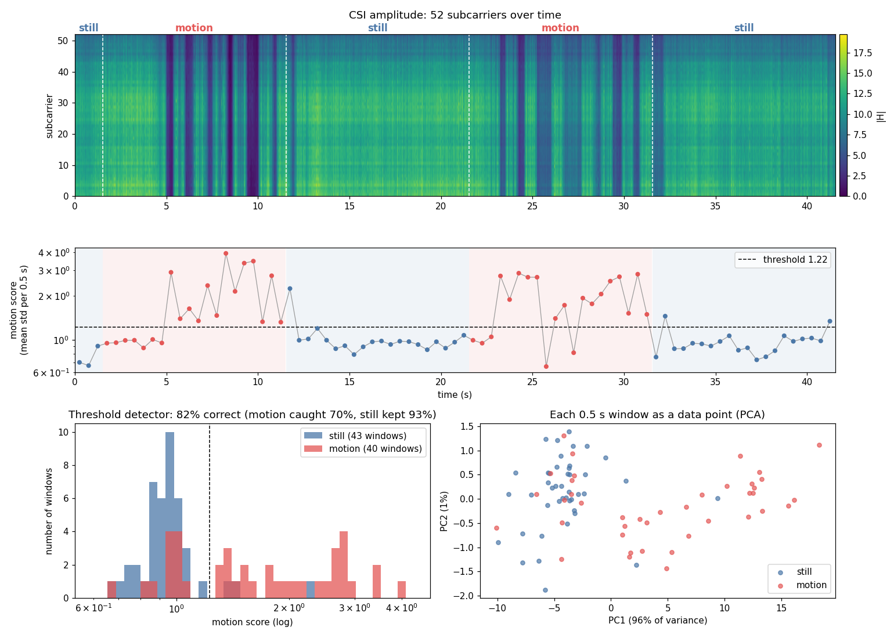
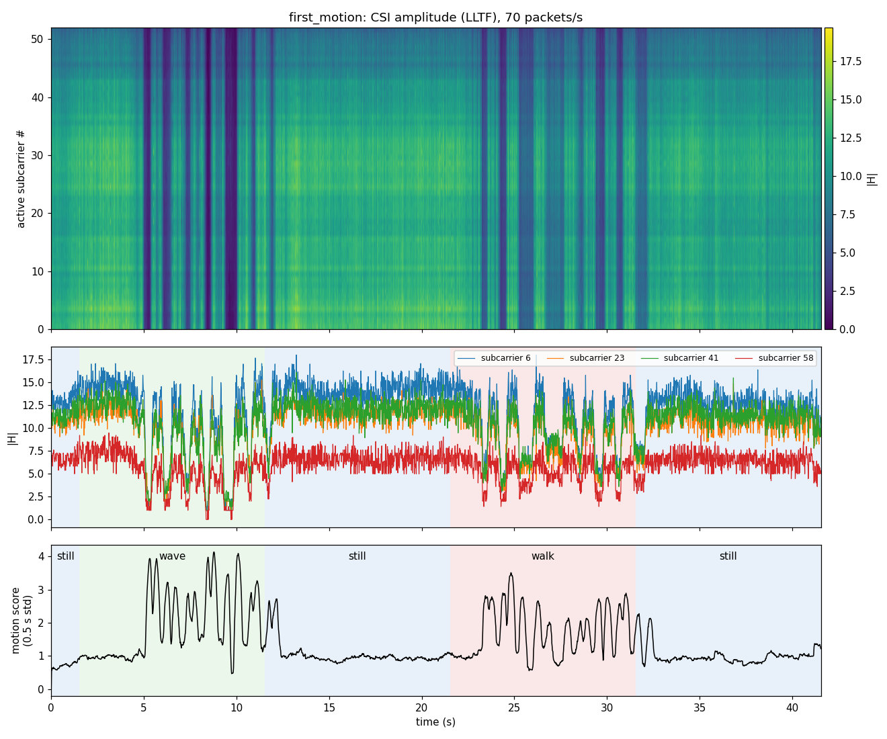
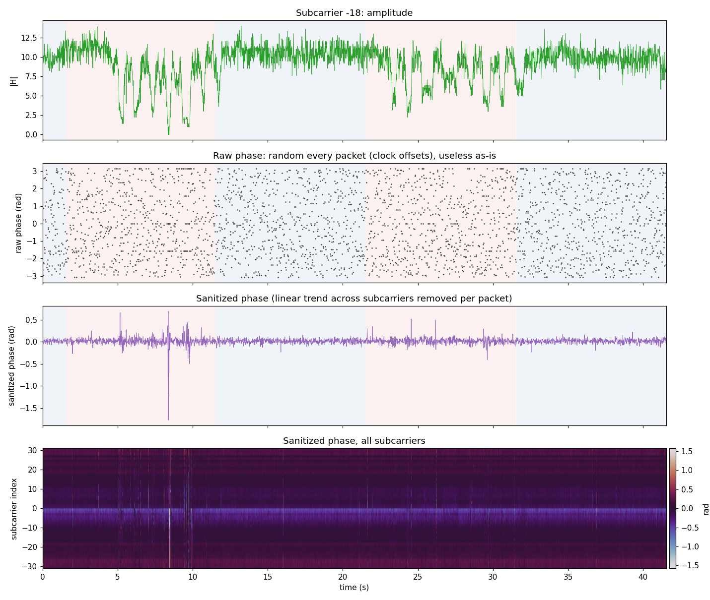

# Pilot runs

Six pilot runs so far. None is a full experiment; together they shaped the current setup.

## Pilot 1: motion detection, one ESP-NOW link (Oct 2026)

- **Hardware:** two ESP32-S3 boards about 80 cm apart, line of sight. Espressif's esp-csi
  `csi_send` / `csi_recv` examples, ESP-NOW on channel 11, about 70 CSI packets/s.
- **Recording:** one 50 s session with spoken cues: still, motion, still, motion, still (10 s
  each). Motion was a hand waving through the link.
- **Method:** amplitude of the 52 active L-LTF subcarriers; motion score = mean per-subcarrier
  standard deviation over 0.5 s windows; a single threshold.

| | Still | Motion |
|---|---|---|
| Median motion score | 0.95 | 1.58 (1.7×) |

- The threshold classifies **82% of 0.5 s windows** correctly (93% of still windows, 70% of motion
  windows). The threshold was chosen on the same recording, so this is not a held-out result.
- Most missed motion windows fall in the first ~3 s of each motion phase, while moving into
  position after the cue.
- At this short range, motion mostly shadows the direct path: all subcarriers dim together,
  so RSSI reacts too.

After removing the linear phase trend across subcarriers, the phase is stable when still and
fluctuates about twice as much during motion:

## Pilot 2: four activities, two ESP-NOW receivers (Oct 12, 2026)

- **Hardware:** one transmitter, two receivers (receivers 1.33 m apart), packets joined across
  receivers by the transmitter's packet counter.
- **Recording:** two short sessions, `empty`, `still`, `walk`, `jump`, at one spot.
- **Method:** hand-made features per 2 s window; Random Forest and RBF-SVM; trained on one
  session and tested on the other.

| Train → test | Majority class | Random Forest | SVM | Shuffled labels (RF) |
|---|---|---|---|---|
| session 1 → 2 | 25.0% | 23.3% | 26.7% | 11.2% |
| session 2 → 1 | 25.0% | 28.4% | 32.8% | 35.3% |

**Result: chance level across sessions.** Likely causes: the actor stood outside the first
Fresnel zone of the links (about 0.25 m wide at that distance), slow drift between sessions,
and very little data.

## Pilot 3: router as transmitter (Oct 24, 2026)

- **Hardware:** a 2.4 GHz router (channel 1, 20 MHz) and two ESP32-S3 receivers running
  `csi_recv_router` with the [firmware patch](../firmware/csi_recv_router.patch); 52 subcarriers.
- **What was established:**
  - Both receivers stream at a steady ~100 packets/s together, once Wi-Fi power save is
    turned off (without it the rate collapses after a few seconds).
  - The subcarrier order of the router firmware's L-LTF buffer was checked on real data.
  - Capture, quality check and dataset building run end to end on real data.
- **Not yet established:** activity accuracy. Only 11 usable clips were recorded, far too few
  to train on. Even in an empty room the amplitude changed about 28% between consecutive
  packets, which is being investigated (see the
  [data collection guide](data_collection.md#8-problems-we-already-hit)).

## Pilot 4: router activity session (Oct 29, 2026)

- **Hardware:** a shared 2.4 GHz router (channel 11) as transmitter, one ESP32-S3 receiver at
  about 3 m (RSSI about −40 dBm). A second receiver averaged only 13 packets/s and was dropped.
- **Recording:** 80 clips of 3 s (20 each of `empty`, `walk`, `sit`, `wave`), shuffled, with
  voice and on-screen cues. The laptop pinged the router at 100 Hz during the session, which
  kept the reply rate up; without it the rate fell to about 10/s.
- **Packets per clip (median, ideal 300):** empty 266, walk 216, sit 54, wave 38. Packets were
  lost when the actor stood on the link, so 30 of 80 clips were too sparse to use.
- **Motion score** (mean over subcarriers of the relative amplitude change in a clip), clips
  with at least 150 packets:

| | empty (13) | walk (17) |
|---|---|---|
| all frequencies | 0.251 | 0.264 |
| 0.3–5 Hz band | 0.162 | 0.202 |

- **Result: walking was not separable from the empty room.** Normalising each packet by its mean
  level did not change this, so it is not simple gain jitter.
- **Unconfirmed suspects:** the router spreading frames over several antennas (pilot 1's
  single-antenna ESP transmitter was much steadier), and an "empty" room that wasn't empty
  (the actor stayed in the room). Next: ESP-to-ESP link, actor outside the room for `empty`,
  and a 1-minute empty-vs-walk check before any full session.

## Pilot 5: small room, three sessions (Oct 31, 2026)

- **Hardware:** a 2.4 GHz router in the same small room (channel 10, RSSI about −35 to −50 dBm)
  as transmitter, two ESP32-S3 receivers. Both boards set to ignore routers weaker than −70 dBm.
- **1-minute checks first** (30–45 s each of empty, wave, walk, sit at the final layout): every
  action scored above the empty room, so the full sessions went ahead.
- **Recording:** two sessions of 40 clips of 5 s (10 each of `empty`, `walk`, `sit`, `wave`),
  shuffled, red/green screen, laptop ping on. All 80 clips flagged `ok`: about 500 packets per
  clip on both boards, longest gap 0.19 s. `empty` = actor outside the room.
- **Motion score** (mean over subcarriers of std / mean in a clip), median per class:

| | empty | sit | wave | walk |
|---|---|---|---|---|
| session 1, board 0 | 0.088 | 0.189 | 0.195 | 0.322 |
| session 1, board 1 | 0.048 | 0.112 | 0.122 | 0.227 |
| session 2, board 0 | 0.106 | 0.170 | 0.143 | 0.290 |
| session 2, board 1 | 0.095 | 0.101 | 0.127 | 0.219 |

- **Sit vs wave** have similar scores but differ in speed: sit is one slow change (share of
  energy above 1 Hz about 0.08), wave repeats about once a second (about 0.3–0.45).
- **Baseline across sessions** (`train_baseline.py` features, 16 per clip; logistic regression;
  trained on one whole session, tested on the other):

| learned on → tested on | accuracy | |
|---|---|---|
| session 1 → session 2 | 77.5% (31/40) | walk 10/10, sit 9/10, wave 9/10, empty 3/10 |
| session 2 → session 1 | 77.5% (31/40) | walk 10/10, empty 8/10, wave 7/10, sit 6/10 |
| shuffled labels (20 tries) | 22.5% | chance is 25% |

- With 40 test clips the 95% range is about 62–88%. Same room, same day, same person.
- **Main error: empty vs sit.** Session 2's empty room was noisier (cause unknown), and a quiet,
  slowly drifting signal looks like a sit.
- **Live test:** `live.py` guesses from the last 5 s every 0.5 s. It gives the same answer as the
  offline pipeline on all 80 recorded clips. In a first 2-minute live try, it rarely said `empty`.
- **Session 3** (42 clips recorded, 33 used): left out 2 clips with stalls, 1 with too few
  packets, 1 wrong action, and 5 `empty` clips that showed walking-level motion for the whole clip,
  cause unknown. Those 5 were chosen after looking at the motion score, so session 3's `empty`
  results are optimistic: with those 5 clips back (38 clips), learning on sessions 1+2 gives 55.3%,
  and 60.5% with per-session rescaling, instead of 63.6% and 75.8%. The new board read about 1.5–2× more relative change for every class.
- **Each session tested after learning on the other two** (113 clips):

| version | session 1 | session 2 | session 3 | all |
|---|---|---|---|---|
| relative features | 70.0% | 72.5% | 63.6% | 69.0% |
| relative + per-session rescaling (no labels) | 77.5% | 82.5% | 75.8% | 78.8% |
| absolute features | 77.5% | 82.5% | 60.6% | 74.3% |
| absolute + per-session rescaling (no labels) | 92.5% | 82.5% | 60.6% | 79.6% |

- Four versions were compared on the same test clips, so small differences may be luck. These
  are within one room; the cross-room test has not been done. `sensing/eval_sessions.py` reproduces
  the relative-feature rows.
- Walk: 29/29 when learning on one session (1→2, 2→1) and on 1+2→3, but 26/29 in the table above.
- **Clock fix:** a board restart resets its clock, which broke the board-to-laptop time fit for
  resumed sessions. `board_time_to_host` now fits each stretch between restarts separately. Sessions
  1 and 2 had no restarts and did not change.
- Data: [release data-2026-10-31](https://github.com/Lakshyaa1/wifi-csi-localization-sensing/releases/tag/data-2026-10-31).

## Pilot 6: a fourth session, a small CNN, label-free adaptation and live tests (Nov 2–6, 2026)

Same room (H), layout, router and boards as pilot 5. Every number below comes from the saved
outputs in [`results/2026-11-06/`](../results/2026-11-06/). CNN training is not exactly repeatable on
this machine, so CNN numbers can move by about 2 points between runs.
Data: [release data-2026-11-06](https://github.com/Lakshyaa1/wifi-csi-localization-sensing/releases/tag/data-2026-11-06).

**Does more data help?** (`learning_curve.py`, sessions 1–3, each tested after learning on the others)

| training clips | 10 | 20 | 40 | all (73–80) |
|---|---|---|---|---|
| logistic regression | 52.7% | 60.0% | 64.3% | 69.0% |

- Still rising, so more sessions help. But the same 16 training clips give 71.2% when they come from
  the test session itself and 54.7% when they come from another session: changes between sessions
  cost more than having few clips.

**Small CNN** (`train_cnn.py`; 88,740 weights; input 2 boards × 52 subcarriers × 250 steps of
relative amplitude change at 50 Hz; 60 epochs, settings fixed in advance, last epoch scored)

- Memorises 16 clips: 16/16 for all 5 seeds, so the model and data handling can learn.
- Each session tested after learning on the other two: **68.7%** (±5.0 over 5 seeds; logistic
  regression 69.0%), with 99.0% right on its own training clips. Shuffled labels: 24.2%.
- Weak on sit: half of all sit clips were called empty, although sit clips move the signal clearly
  more than empty ones (`sit_check.py`: a sit clip is stronger than an empty clip 92% of the time).
  Neither leaving session 3 out nor keeping each pattern's peak (mean + max over time, 71.9%) fixed
  sit, so the averaging version was kept.

**Session 4** (Nov 6; 40 clips, 39 usable; one walk clip flagged for a 1.01 s stall)

- Every action moved the signal more than in sessions 1–3 (old board, median: empty 0.199 vs
  0.071–0.124, sit 0.316 vs 0.161–0.184), cause unknown.
- Learned on sessions 1–3: logistic regression **41.0%** (16/39), CNN **56.4%** (5 seeds,
  48.7–64.1%). Errors moved one step up: logistic regression called all 10 empty clips sit and all 10
  sit clips walk.

**Label-free adaptation to session 4** (`adapt.py`; Adam, lr 1e-4, weight decay 1e-4, 50 epochs, as
in the MU-SHOT-Fi code's target stage; last epoch; labels used only for scoring)

| | no adaptation | AdaBN | SHOT-IM |
|---|---|---|---|
| adapt and score on the same 39 clips | 56.4% | 67.2% | 87.7% |
| adapt on one half, score the other half | 56.4% | 66.7% | **81.5%** (69.2–92.3%) |

- Every seed improved, by 21–39 points held out. SHOT-IM changed the feature layers by 4–7% and the
  final layer by 0.0%, as intended.
- Session 4 is almost exactly balanced (10/10/9/10), which SHOT-IM's "stay varied" term assumes.
  Robustness to unbalanced data is not tested yet.

**Live tests**

- A free 5-minute live run with the adapted CNN flickered between labels every few seconds. Sitting
  still is not one of the actions (`sit` = sitting down and standing up), so it came out as empty or sit.
- Scripted live test: 9 blocks of 30 s (empty, sit, walk, wave ×2, plus 1 block of sitting still),
  scored on 5 s windows every 0.5 s (408 windows of the four actions; they overlap heavily, so they
  count as far fewer independent samples).

| model | windows right |
|---|---|
| logistic regression, sessions 1–4 | 46.8% |
| CNN adapted to session 4 | 43.9% |
| CNN, sessions 1–3, no adaptation | 54.5% |
| CNN + AdaBN on the live test (no labels) | **68.6%** |
| CNN + SHOT-IM on the live test (no labels) | 65.8% |
| best calibration with labelled live blocks (logistic regression, sessions 1–4 + one block per action) | 69.4% |

- The live test moved the signal less than session 4 (old board: sit 0.128, walk 0.223), so errors
  moved one step down: walk was called wave (97% with the session-4 CNN). Adapting to the live test
  fixed walk (98–99%). Empty vs sit stayed near 40/40, as the live sit blocks barely rose above empty.
- Sitting still: 100% called empty by the session-4 CNN.

**Conclusions so far**

- The signal's overall strength drifts between sessions, even within one hour in one room, and both
  models judge actions mostly by strength. Errors move up or down a whole step together.
- Label-free adaptation undoes much of that on recorded clips (session 4: 56.4% → 81.5% held out).
  This is the MU-SHOT-Fi effect between days in one room; the cross-room test is next.
- A live classifier needs more than this: a class for sitting still or coarser classes, a way to
  follow drift, and possibly better placement. A short labelled calibration did not clearly help.

**Recording problems this pilot**

- Each serial-port open restarts the boards; the first login to the router fails and can take
  35 s, and many restarts in a few minutes made the router refuse them. `record.py` now waits up to
  90 s (`--warmup`) and stops its ping if it gives up.
- Stalls of 1–15 s per 30 s clip on both boards at once, on and off; not caused by the recorder,
  and laptop ping times did not predict them. Two 1-minute checks were discarded for this reason.

## Pilot code

The ESP-NOW pilots used the scripts in [`espnow_pilot/`](../espnow_pilot/):

| File | Purpose |
|---|---|
| `logger.py` | Record labelled CSI from one or more `csi_recv` receivers (`boards.csv` maps USB serials to roles) |
| `merge.py` | Merge recordings made on two laptops, by packet id |
| `preprocess.py` | Join receivers on packet id, filter, resample, window |
| `features.py`, `train_classical.py` | Hand-made features; Random Forest / SVM with majority and shuffled-label checks |
| `plot_csi.py`, `plot_session.py`, `static_vs_motion.py`, `analyze_csi.py`, `phase_check.py` | Plots and pilot 1 analysis |
| `live_view.py` | Live activity level and amplitude view from connected receivers |
| `layout.py` | Board and zone coordinates |

Known issue: `preprocess.py` reorders subcarriers as if the ESP-NOW buffer were 0..31, −32..−1.
On our boards that buffer is already in frequency order, so the reorder (and the phase
sanitization that depends on it) is wrong. Amplitude features per subcarrier are unaffected.
